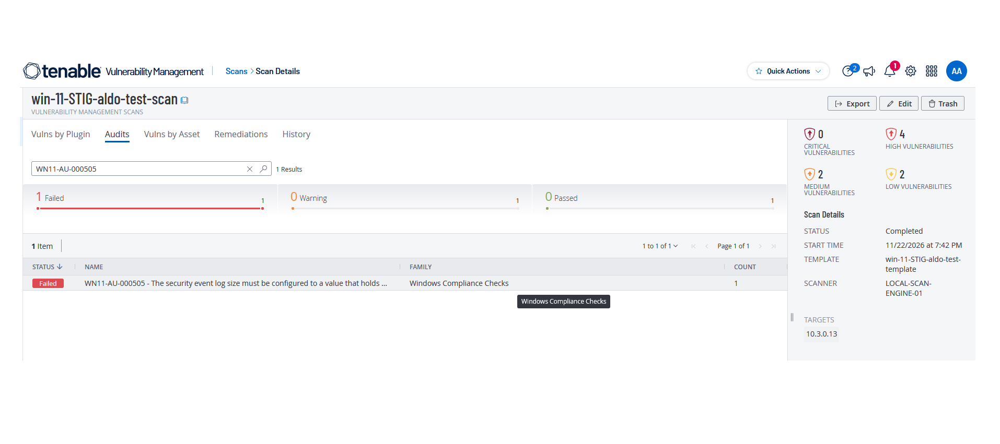
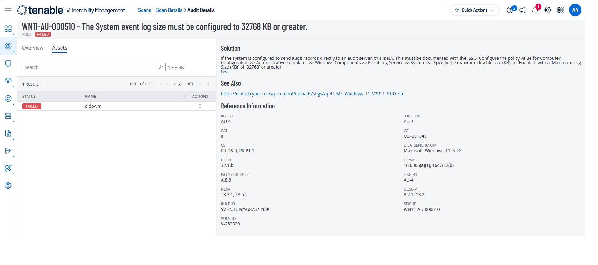
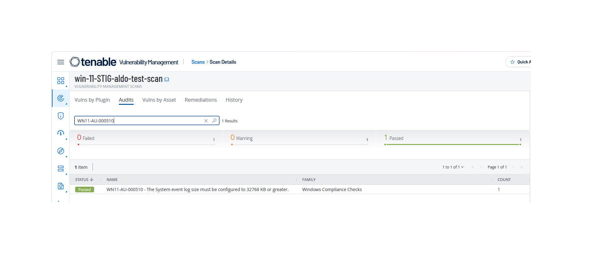

# Windows 11 STIG Remediations 🔒

PowerShell scripts that remediate failed DISA STIG checks on a Windows 11 Pro VM in Azure, completed as part of my LOG(N) Pacific cybersecurity internship.

## Method

Each STIG follows the same three steps:

1. **Scan:** run an authenticated Tenable compliance scan using the DISA Microsoft Windows 11 STIG audit and identify the failed check.
2. **Remediate:** write and run a PowerShell script that applies the required setting.
3. **Verify:** rescan with Tenable and confirm the check now passes.

**Environment:** Windows 11 Pro (Azure VM) · Tenable Vulnerability Management (LOCAL-SCAN-ENGINE-01) · DISA Microsoft Windows 11 STIG V2R11 · PowerShell 5.1

## Remediated STIGs

| # | STIG ID | What it fixes | Script | Result |
|---|---|---|---|---|
| 1 | WN11-AU-000505 | Security event log must hold at least a week of audit records (MaxSize ≥ 5120000 KB) | [STIG-ID-WN11-AU-000505.ps1](STIG-ID-WN11-AU-000505.ps1) | ✅ Passed |
| 2 | WN11-AU-000510 | System event log must be 32768 KB or greater | [STIG-ID-WN11-AU-000510.ps1](STIG-ID-WN11-AU-000510.ps1) | ✅ Passed |

## Evidence

### 1. WN11-AU-000505: Security event log size

**Finding:** no maximum size was configured for the Security event log, so audit records could be overwritten before anyone reviewed them. Tenable expects a value of at least 5120000 KB.

**Fix:** set `MaxSize = 5120000` (DWORD) under `HKLM:\SOFTWARE\Policies\Microsoft\Windows\EventLog\Security`. This is an upper limit, so Windows doesn't reserve the disk space up front.

Before: check failed

Remediation: script run

After: check passed

### 2. WN11-AU-000510: System event log size

**Finding:** no maximum size was configured for the System event log. If the log is too small, older events are overwritten quickly and lost before anyone can investigate them. Tenable expects a value of at least 32768 KB.

**Fix:** set `MaxSize = 32768` (DWORD) under `HKLM:\SOFTWARE\Policies\Microsoft\Windows\EventLog\System`.

Before: check failed

Remediation: script run

After: check passed

---

Part of my [Cybersecurity Internship Portfolio](https://github.com/aldoAnthony/Cyber-Security-Internship-Portfolio).
