# Windows 11 STIG Remediation with PowerShell

Remediating 10 failed DISA STIG checks on a Windows 11 virtual machine in Azure. I found the failures with a Tenable Vulnerability Management compliance scan, fixed each one with a PowerShell script, and confirmed the fixes with a second scan.

---

## Overview

| | |
|---|---|
| **Target** | Windows 11 Pro VM (Azure) |
| **Benchmark** | DISA Microsoft Windows 11 STIG v2r11 |
| **Scanner** | Tenable Vulnerability Management (credentialed compliance scan) |
| **Remediation** | PowerShell (registry-based policy configuration) |
| **Initial scan** | 153 failed / 11 warning / 94 passed |
| **After remediation** | 143 failed / 11 warning / 104 passed (all 10 targeted checks: FAILED → PASSED) |

### Full scan results

<details>
<summary>Before remediation: 153 failed / 94 passed</summary>

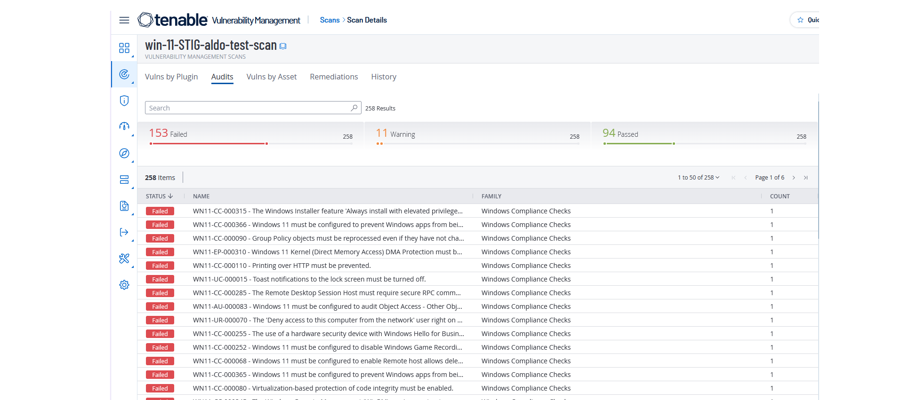

</details>

<details>
<summary>After remediation: 143 failed / 104 passed</summary>

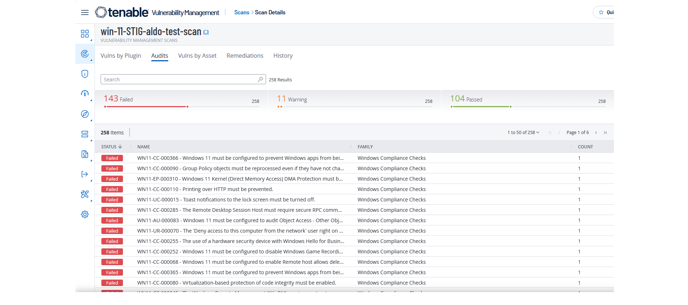

</details>

## Workflow

```
1. Deploy        Windows 11 VM in Azure
2. Scan          Tenable credentialed scan with the DISA Windows 11 STIG audit
3. Triage        Pick 10 failed checks (low-risk, registry-based, verifiable)
4. Evidence      Capture "before" state: audit result + actual vs policy value
5. Remediate     Run a PowerShell script per STIG (sets the value, verifies it)
6. Rescan        Run the same scan again
7. Validate      Confirm every check moved from FAILED to PASSED
```

---

## Remediated STIGs

| # | STIG ID | CAT | What it fixes | Registry value set | Script |
|---|---|:---:|---|---|---|
| 1 | WN11-AU-000505 | II | Security event log size ≥ 5120000 KB | `EventLog\Security\MaxSize = 5120000` | [script](STIG-ID-WN11-AU-000505/STIG-ID-WN11-AU-000505.ps1) |
| 2 | WN11-AU-000510 | II | System event log size ≥ 32768 KB | `EventLog\System\MaxSize = 32768` | [script](STIG-ID-WN11-AU-000510/STIG-ID-WN11-AU-000510.ps1) |
| 3 | WN11-CC-000005 | II | Disables camera access from the lock screen | `Personalization\NoLockScreenCamera = 1` | [script](STIG-ID-WN11-CC-000005/STIG-ID-WN11-CC-000005.ps1) |
| 4 | WN11-CC-000010 | II | Disables slide shows on the lock screen | `Personalization\NoLockScreenSlideshow = 1` | [script](STIG-ID-WN11-CC-000010/STIG-ID-WN11-CC-000010.ps1) |
| 5 | WN11-CC-000180 | I | Turns off AutoPlay for non-volume devices | `Explorer\NoAutoplayfornonVolume = 1` | [script](STIG-ID-WN11-CC-000180/STIG-ID-WN11-CC-000180.ps1) |
| 6 | WN11-CC-000185 | I | Blocks autorun commands | `Policies\Explorer\NoAutorun = 1` | [script](STIG-ID-WN11-CC-000185/STIG-ID-WN11-CC-000185.ps1) |
| 7 | WN11-CC-000190 | I | Turns off AutoPlay for all drives | `Policies\Explorer\NoDriveTypeAutoRun = 255` | [script](STIG-ID-WN11-CC-000190/STIG-ID-WN11-CC-000190.ps1) |
| 8 | WN11-CC-000315 | I | Disables "Always install with elevated privileges" | `Installer\AlwaysInstallElevated = 0` | [script](STIG-ID-WN11-CC-000315/STIG-ID-WN11-CC-000315.ps1) |
| 9 | WN11-CC-000330 | I | Stops the WinRM client from using Basic authentication | `WinRM\Client\AllowBasic = 0` | [script](STIG-ID-WN11-CC-000330/STIG-ID-WN11-CC-000330.ps1) |
| 10 | WN11-CC-000326 | II | Turns on PowerShell script block logging | `ScriptBlockLogging\EnableScriptBlockLogging = 1` | [script](STIG-ID-WN11-CC-000326/STIG-ID-WN11-CC-000326.ps1) |

**5 of the 10 are CAT I (high severity)** findings.

---

## How each script works

Every script follows the same pattern:

1. **Requires admin.** `#Requires -RunAsAdministrator` stops the script straight away if the session isn't elevated.
2. **Creates the policy key** if it doesn't exist.
3. **Sets the required value** as a `DWORD`.
4. **Reads the value back** and prints a green `SUCCESS` or a red `FAILED` line (exit code 1 on failure).

```powershell
.\STIG-ID-WN11-AU-000505.ps1
# SUCCESS: 'MaxSize' is set to '5120000' KB at 'HKLM:\SOFTWARE\Policies\Microsoft\Windows\EventLog\Security'. WN11-AU-000505 remediated.
```

---

## Evidence

Each STIG folder contains the script and its screenshots:

```
STIG-ID-WN11-XX-000000/
├── STIG-ID-WN11-XX-000000.ps1
├── 1-before-audit.png       # Tenable Audits tab: FAILED
├── 2-before-details.png     # Audit details: solution + references
├── 3-before-output.png      # Asset output: NULL vs policy value
├── 4-during.png             # PowerShell: SUCCESS + registry check
├── 5-after-audit.png        # Tenable Audits tab: PASSED
└── 6-after-output.png       # Asset output: new value
```

### STIG 1: WN11-AU-000505 (Security event log size)

| Before | After |
|---|---|
| 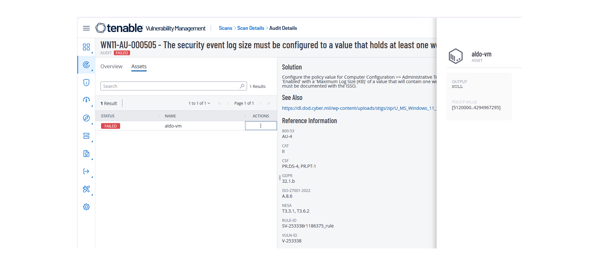 | 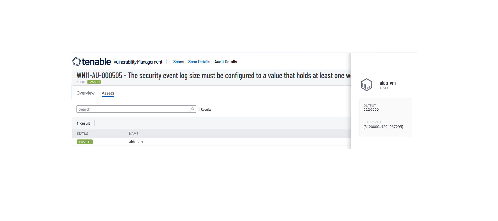 |

**Remediation:** 

### STIG 2: WN11-AU-000510 (System event log size)

| Before | After |
|---|---|
| 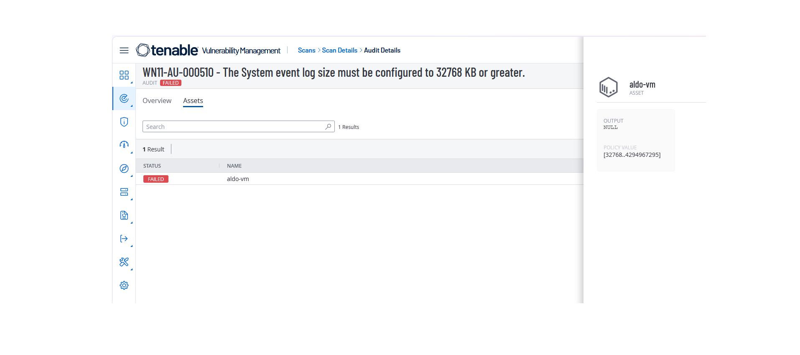 | 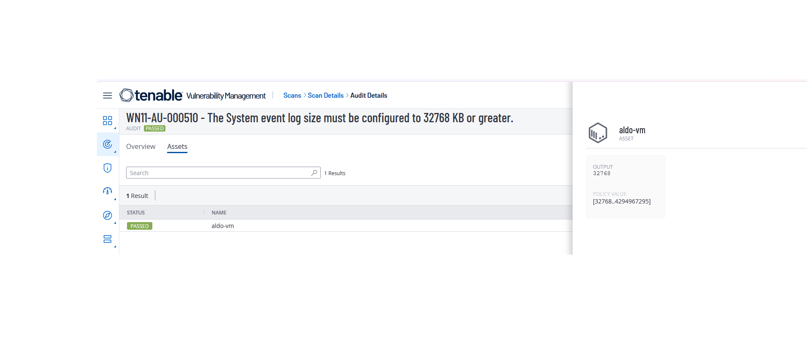 |

**Remediation:** 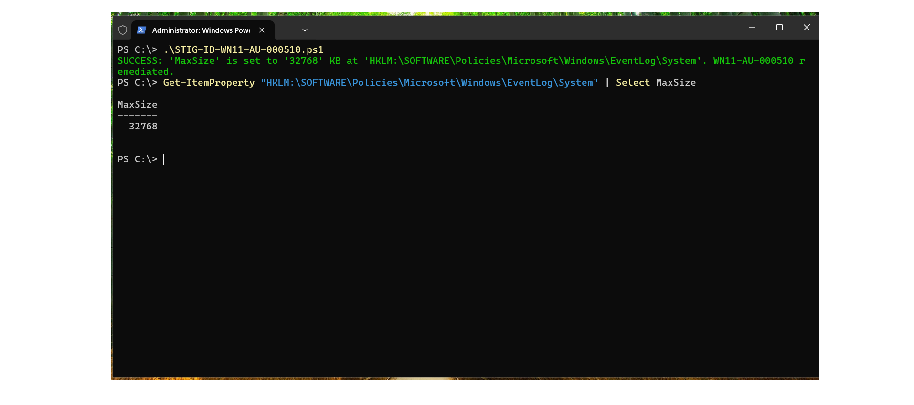

### STIG 3: WN11-CC-000005 (Lock screen camera)

| Before | After |
|---|---|
| 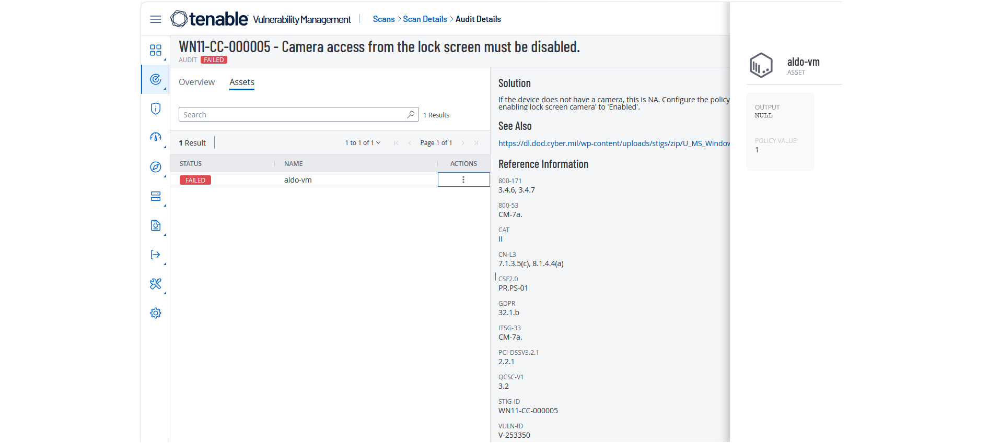 | 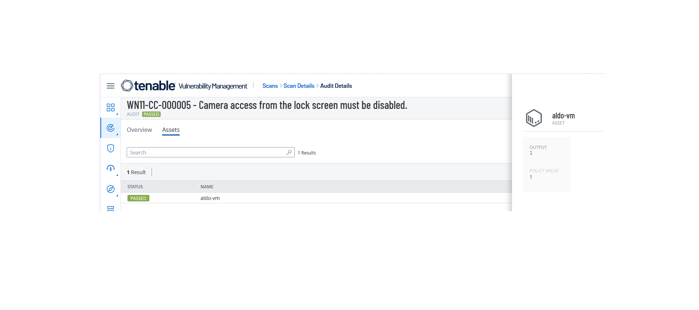 |

**Remediation:** 

### STIG 4: WN11-CC-000010 (Lock screen slideshow)

| Before | After |
|---|---|
| 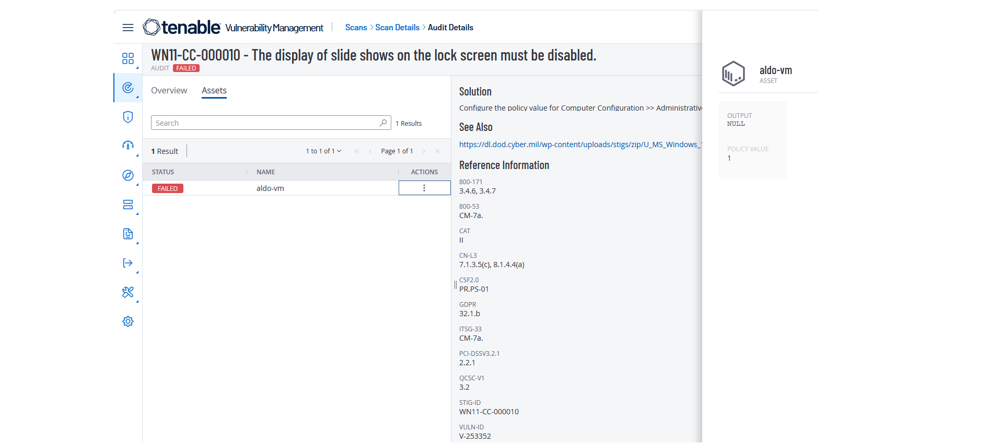 | 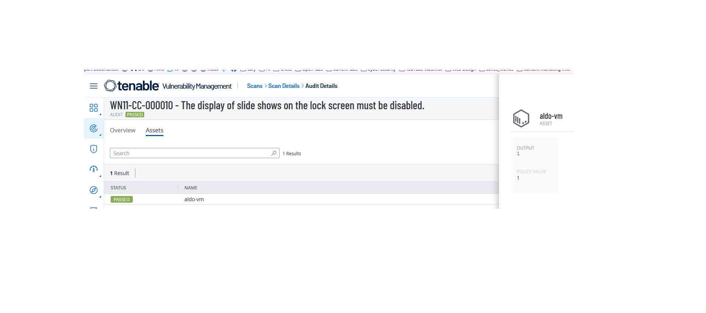 |

**Remediation:** 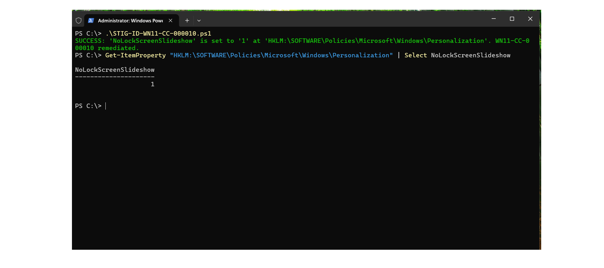

### STIG 5: WN11-CC-000180 (AutoPlay, non-volume devices)

| Before | After |
|---|---|
| 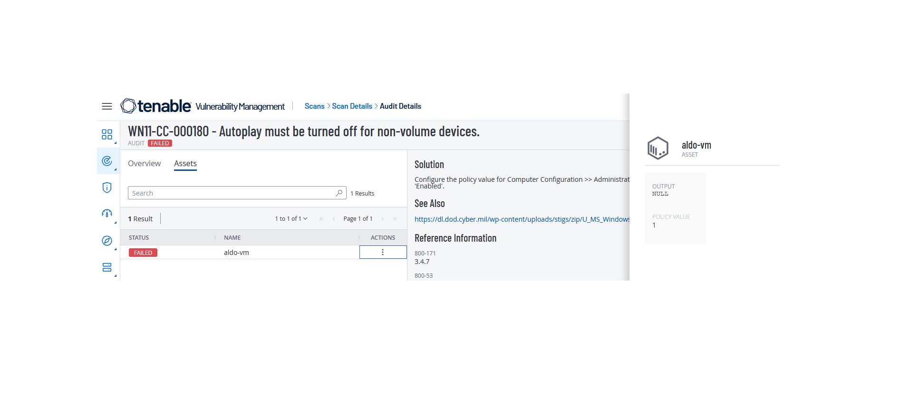 |  |

**Remediation:** 

### STIG 6: WN11-CC-000185 (Autorun commands)

| Before | After |
|---|---|
|  |  |

**Remediation:** 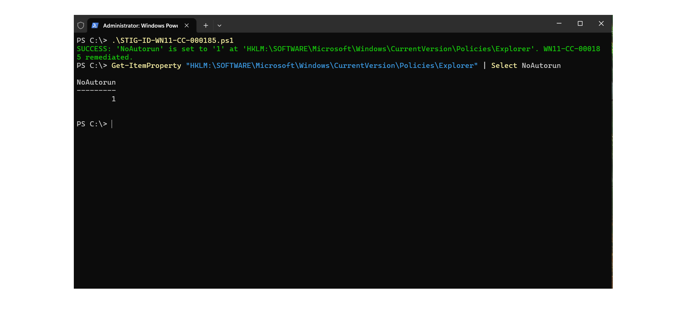

### STIG 7: WN11-CC-000190 (AutoPlay, all drives)

| Before | After |
|---|---|
| 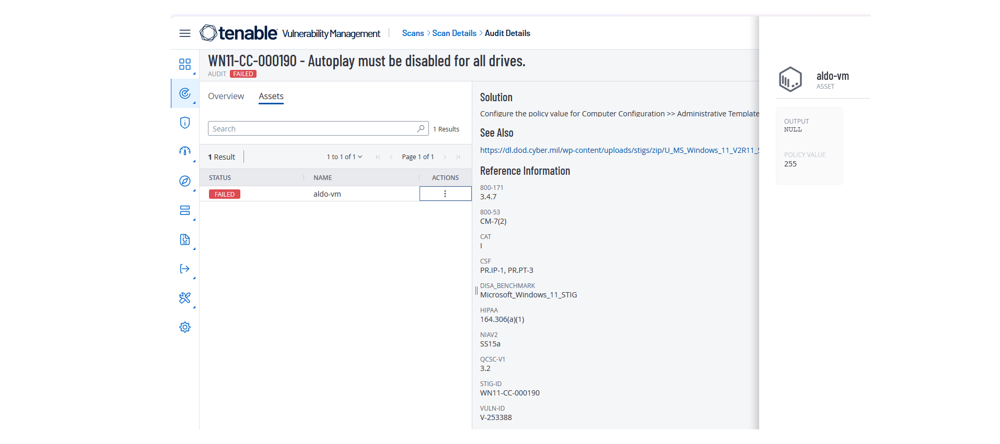 |  |

**Remediation:** 

### STIG 8: WN11-CC-000315 (Always install elevated)

| Before | After |
|---|---|
| 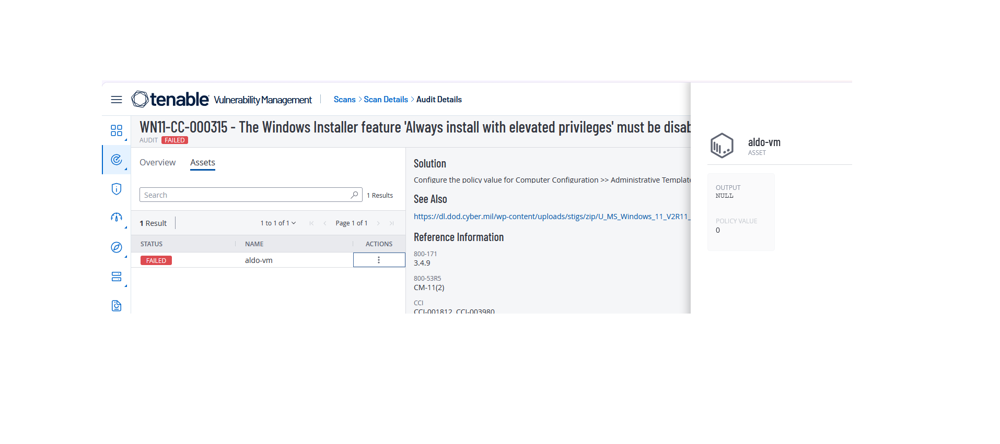 | 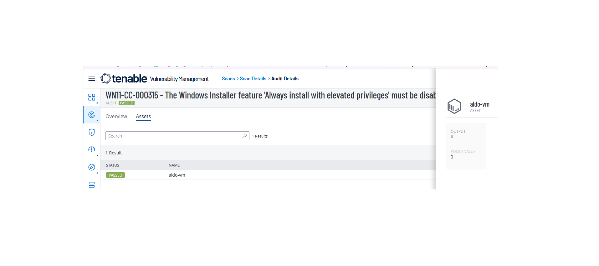 |

**Remediation:** 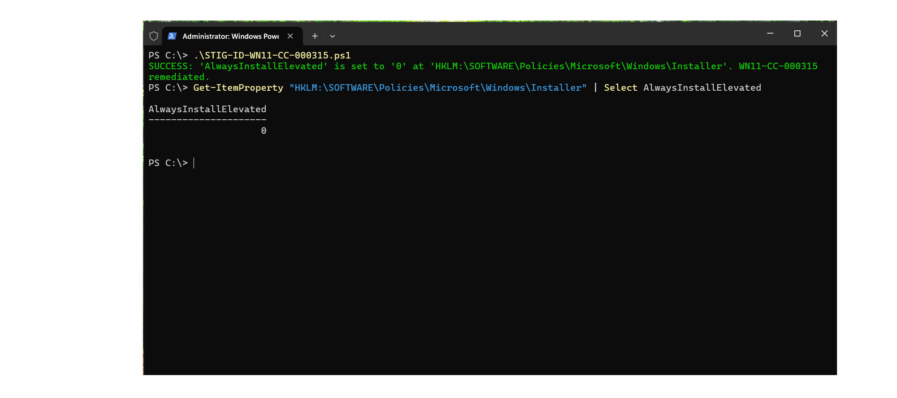

### STIG 9: WN11-CC-000330 (WinRM client Basic auth)

| Before | After |
|---|---|
| 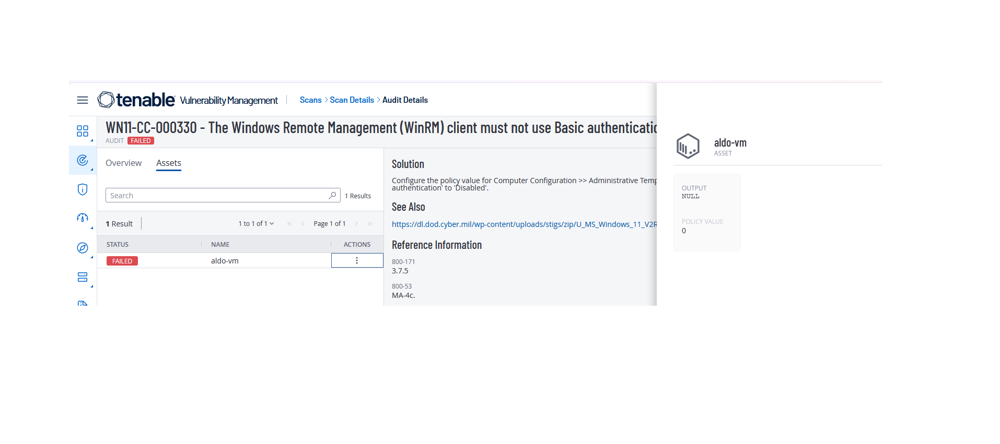 | 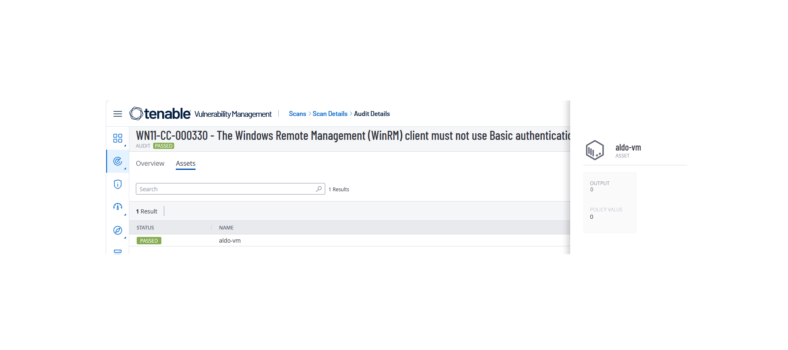 |

**Remediation:** 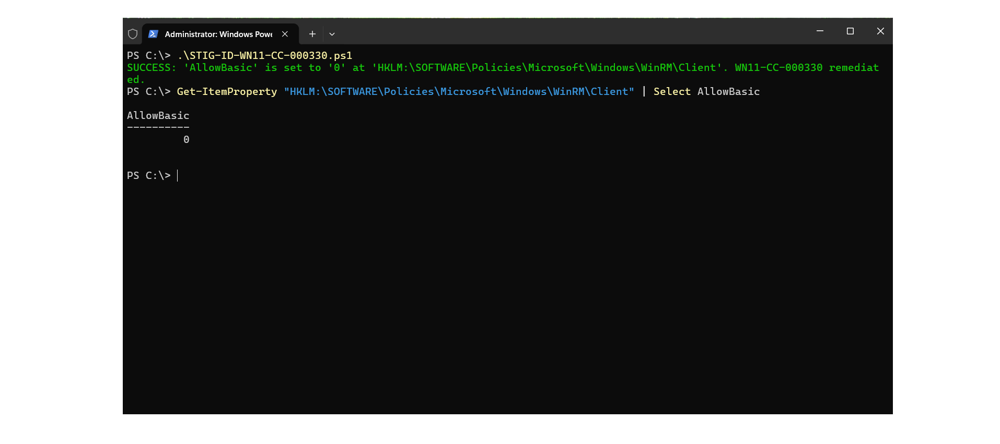

### STIG 10: WN11-CC-000326 (PowerShell script block logging)

| Before | After |
|---|---|
| 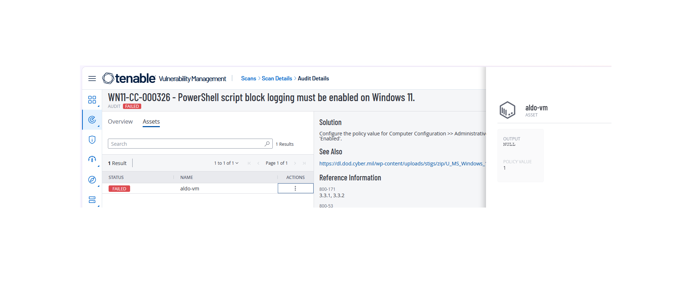 | 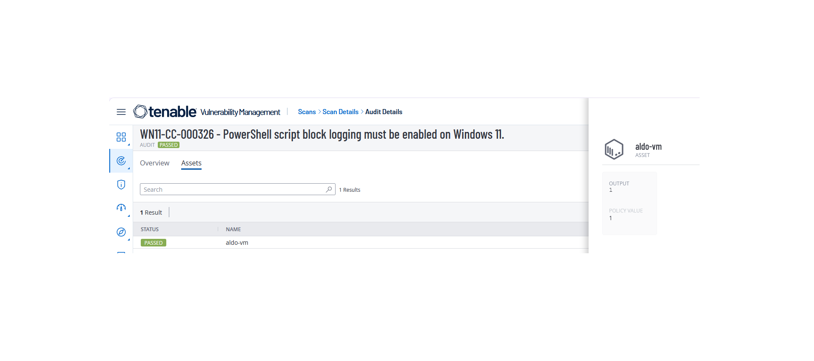 |

**Remediation:** 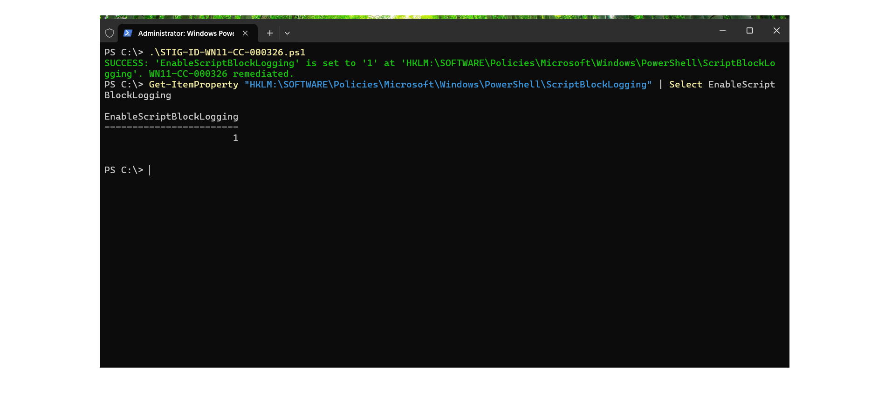

---

## Why these 10

I deliberately chose checks that are:

- **Registry-based.** Each one is a single, verifiable value, so the before (`NULL`) and after states are clear.
- **Safe for a remote cloud VM.** I avoided user-rights (UR), NTLM/LanMan and RDP-related checks that could cut off remote access to the Azure VM.
- **Security-relevant.** They cover privilege escalation (`AlwaysInstallElevated`), credential exposure (WinRM Basic auth), removable-media malware (AutoRun/AutoPlay), physical-access risks (lock screen) and audit/detection coverage (event log sizing, script block logging).

## Key takeaways

- **Compliance scanners check configured policy, not effective behaviour.** `AlwaysInstallElevated` is already off by default, but the STIG still fails until the value is explicitly set to `0`. The asset output showing `NULL` makes this clear.
- **Check what the scanner actually expects.** The STIG text for WN11-AU-000505 says "one week's worth of audit records", while the Tenable audit enforces a minimum of **5120000 KB**. I read the policy value in the asset output before writing the script.
- **Hardening and detection go together.** Script block logging (WN11-CC-000326) writes Event ID **4104** to `Microsoft-Windows-PowerShell/Operational`, which records de-obfuscated PowerShell for threat hunting in Sentinel and MDE.
- **Batch the rescans.** Capturing all "before" evidence first, remediating everything, then running one rescan saved several hours compared with rescanning after each fix.

## Tools

- Microsoft Azure (Windows 11 Pro VM)
- Tenable Vulnerability Management
- DISA Windows 11 STIG v2r11
- PowerShell 5.1 / Windows Terminal

---

**Author:** Aldo Anthony · [LinkedIn](https://www.linkedin.com/in/aldoanthony) · [GitHub](https://github.com/aldoAnthony)

Part of my [Cybersecurity Internship Portfolio](https://github.com/aldoAnthony/Cyber-Security-Internship-Portfolio).
